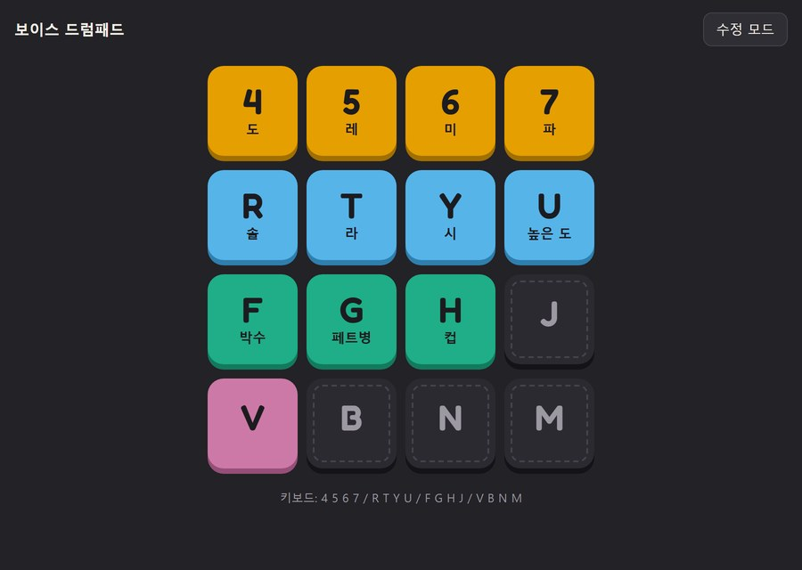
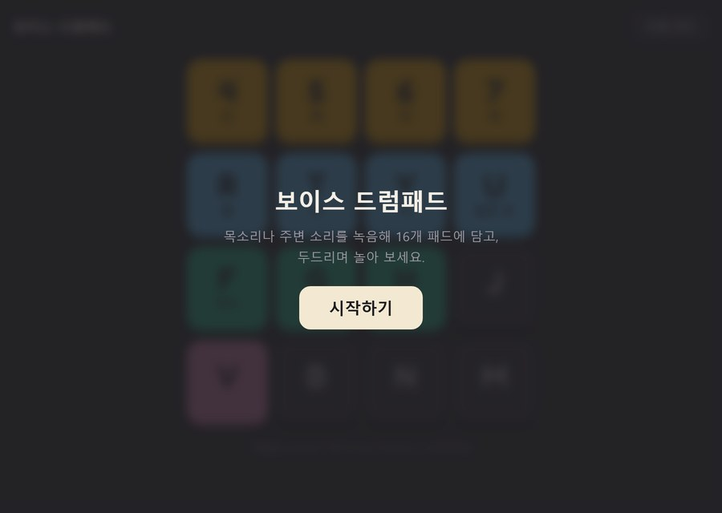
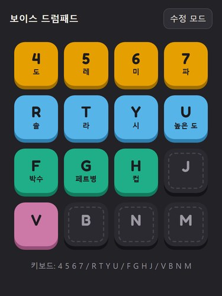
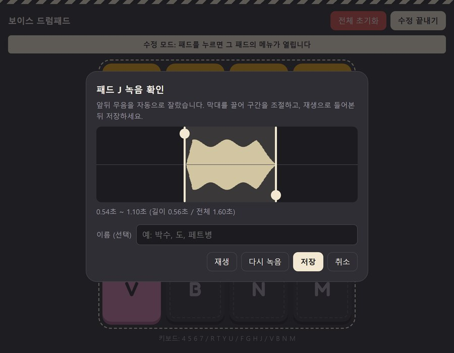
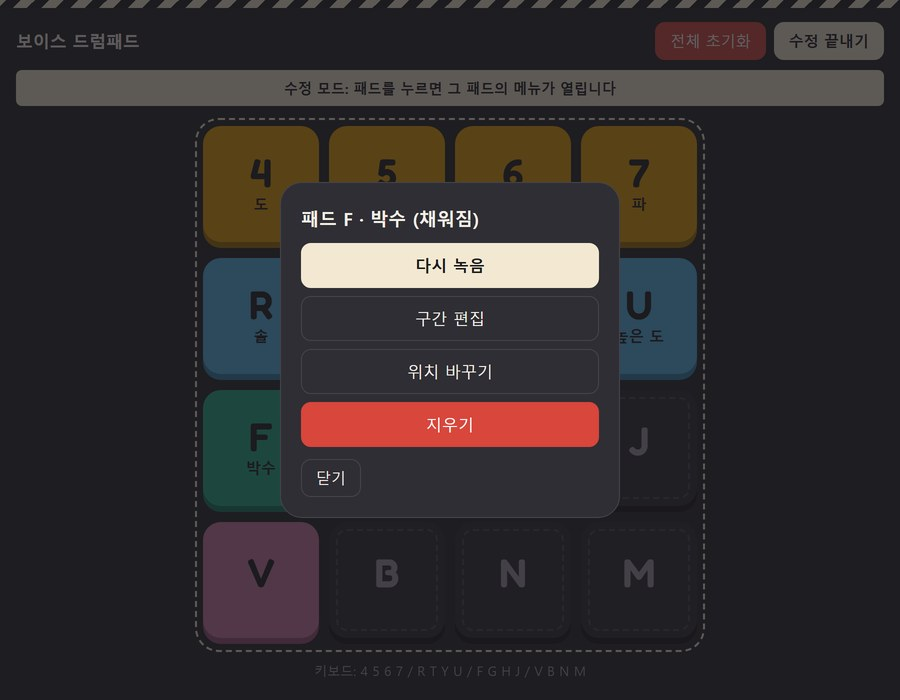
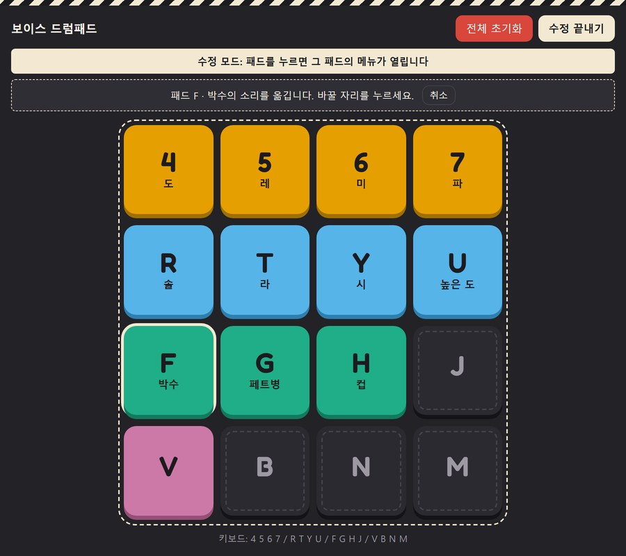

# 🥁 보이스 드럼패드

<p align="center"></p>

> 내 목소리나 박수, 페트병, 컵 두드리는 소리를 직접 녹음해 16개 패드에 담고, 드럼패드처럼 두드리며 노는 웹앱

| 바로 써 보기 | 주소 |
|---|---|
| 웹사이트 | https://ratitbe.github.io/drumpad/ |
| 저장소 | https://github.com/RatItBe/drumpad |

- 과제: AI로 웹앱 만들기 (중간고사 대체 과제, 바이브 코딩)
- 지난 실습 과제는 제출하지 않아서, **새 앱을 처음부터** 만들었습니다.
- 만든 사람: 컴퓨터공학과 2022108123 제갈유성
- 제작 도구: Claude Code (Claude 데스크톱 앱)
- 실행 환경: 웹 브라우저 (PC 크롬, 안드로이드 크롬, 아이폰 사파리). 설치·로그인·서버 없음

### 목차

1. [제작한 것 소개](#1-제작한-것-소개) — 만든 이유, 화면, 사용법, 기능, 구조, 한계
2. [PRD와 Todo 리스트](#2-prd와-todo-리스트)
3. [Todo 리스트 변경 내역](#3-todo-리스트-변경-내역) — 처음 계획과 비교
4. [스킬](#4-스킬) — 직접 만든 스킬 2개
5. [느낀점, 결론](#5-느낀점-결론)

---

## 1. 제작한 것 소개

### 왜 만들었나

웹앱에 맞는 아이디어를 찾는 데서 출발했습니다. 처음에는 사진을 올리고 그 옆에 일기를 적는 웹앱을 생각했는데, 브라우저 캐시를 지우기만 해도 올려 둔 사진이 전부 사라지고, 사진은 용량이 커서 브라우저에 다 담아 두기에도 맞지 않았습니다. 그건 웹앱보다 그냥 앱으로 만드는 게 맞는 아이디어였습니다. 그래서 마이크와 소리처럼 브라우저가 이미 잘하는 것으로, 저장할 것도 짧은 녹음 몇 개뿐이라 브라우저 안에서 끝나는 앱을 골랐습니다. 내 목소리나 주변 물건 소리로 패드를 채워 두드리는 드럼패드입니다.

### 무엇을 하나

드럼패드는 원래 정해진 드럼 소리를 내는 기계입니다. 보이스 드럼패드는 그 소리를 **사용자가 직접 녹음한 소리**로 채웁니다. 8칸에 "도레미파솔라시도"를 불러 넣으면 작은 건반이 되고, 나머지 칸에 박수·페트병·컵 소리를 넣으면 드럼이 됩니다. 어떻게 채울지는 정해 두지 않았습니다.

### 화면

맨 위 그림이 연주 화면입니다. 줄마다 색이 다르고, 이름을 붙인 패드는 키 글자 아래에 이름이 보입니다.

| 시작 화면 | 휴대폰 |
|:---:|:---:|
|  |  |

| 녹음 확인 (녹음 직후) | 수정 모드 패드 메뉴 | 위치 바꾸기 |
|:---:|:---:|:---:|
|  |  |  |

> 스크린샷의 소리는 화면을 보여 주려고 만든 예시 소리입니다. 실제로는 마이크로 녹음합니다.

### 30초 사용법

1. **시작하기**를 누릅니다. 아이폰은 화면을 한 번 눌러야 소리가 나서 이 버튼이 있습니다.
2. 오른쪽 위 **수정 모드**를 켜고 빈 패드를 누른 뒤 **녹음**을 고릅니다.
3. **녹음 시작**을 누르고 소리를 냅니다. 5초가 지나면 저절로 멈춥니다.
4. **녹음 확인** 화면에서 앞뒤 무음이 잘린 위치를 확인합니다. 막대를 끌어 조절하고 **재생**으로 들어 본 뒤, 이름을 붙이거나 비워 두고 **저장**합니다.
5. **수정 끝내기**를 누르고 패드를 두드립니다. 키보드로도 칠 수 있습니다.

```
4 5 6 7
R T Y U
F G H J
V B N M
```

### 주요 기능

- **녹음**: 패드마다 최대 5초. 녹음 중에는 빨간 점과 경과 시간이 보입니다. 마이크 권한은 수정 모드에서 처음 녹음할 때 한 번만 묻고, 수정 모드를 끄면 마이크를 놓습니다. 권한이 거부되면 이유와 브라우저별 해결 방법을 알려 줍니다.
- **앞뒤 무음 자동 자르기**: 10ms 단위로 소리 크기를 재서 조용한 앞뒤를 잘라 냅니다.
- **녹음 확인과 구간 편집**: 전체 파형 위에서 시작·끝 막대를 마우스나 손가락으로 끌어 조절합니다. 원본은 지우지 않고 시작점·끝점만 저장하므로, 나중에 막대를 넓히면 잘렸던 부분이 되살아납니다.
- **연주**: 클릭·터치·키보드. 여러 패드를 동시에 칠 수 있고, 같은 패드를 연타하면 소리가 겹쳐 납니다. 빈 패드를 누르면 살짝 흔들립니다.
- **한글 입력 상태에서도 키보드 연주**: 글자가 아니라 키의 물리적 위치로 판별합니다.
- **패드 이름**: "박수", "도"처럼 이름을 붙이면 패드에 표시됩니다. 비워 두면 키 글자만 보입니다.
- **수정 모드**: 다시 녹음, 구간 편집, 위치 바꾸기(교환 또는 빈 칸으로 이동), 지우기, 전체 초기화.
- **저장**: 브라우저 안(IndexedDB)에 녹음 원본을 그대로 저장합니다. 새로고침하거나 브라우저를 다시 열어도 남아 있습니다.
- **휴대폰 대응**: 빠르게 두드려도 화면 확대, 글자 선택, 길게 누르기 메뉴가 뜨지 않습니다.

### 기술과 구조

| 구분 | 사용한 것 |
|---|---|
| 화면 | HTML, CSS, JavaScript (프레임워크·빌드 도구 없음) |
| 녹음 | `getUserMedia`, `MediaRecorder` (크롬은 webm, 사파리는 mp4) |
| 재생·자르기·파형 | Web Audio API (`AudioContext`, `AudioBuffer`), Canvas |
| 저장 | IndexedDB, `navigator.storage.persist()` |
| 입력 | Pointer Events, `KeyboardEvent.code` |
| 외부 라이브러리 | 없음. 키 글자 글꼴(Fredoka)만 Google Fonts 에서 받고, 인터넷이 없으면 시스템 글꼴로 바뀐다 |

```
drumpad/
├── index.html          화면 구조: 시작 화면, 패드, 메뉴·녹음·구간 편집 창
├── style.css           패드 상태, 눌림·흔들림 효과, 수정 모드 표시, 휴대폰 대응
├── script.js           녹음, 재생, 무음 자르기, 구간 편집, 저장, 수정 모드
├── docs/
│   ├── PRD.md          처음 계획 (고치지 않고 그대로) + 바뀐 점 요약
│   ├── TODO.md         할 일, 변경 내역, 검증 기록
│   └── screenshots/
└── .claude/skills/
    ├── drumpad-audio-rules/SKILL.md   브라우저별 오디오 규칙과 마이크 없이 검증하는 법 (직접 만듦)
    ├── drumpad-todo-cycle/SKILL.md    TODO 한 칸 끝낼 때의 순서 (직접 만듦)
    └── frontend-design/SKILL.md       생성된 티가 나지 않는 화면 디자인 기준 (Anthropic 공개 스킬)
```

### 직접 실행하기

설치·빌드·서버가 필요 없습니다. 파일 세 개(`index.html`, `style.css`, `script.js`)가 전부입니다.

- **온라인**: 위 웹사이트 주소를 엽니다. 휴대폰도 같은 주소입니다.
- **내 컴퓨터**: `Code → Download ZIP` 으로 받아 압축을 풀고 `index.html` 을 더블클릭합니다. PC 크롬에서는 이렇게 열어도 마이크를 쓸 수 있습니다. 파일로 열면 크롬이 마이크 권한을 기억하지 않아서, 수정 모드에 들어가 처음 녹음할 때마다 한 번 허용을 묻습니다.
- 녹음한 소리는 **연 주소별로** 브라우저 안에 저장됩니다. 웹사이트에서 녹음한 것은 파일로 열었을 때 보이지 않고, 그 반대도 같습니다.

### 한계

- **아직 실제 기기에서 다 확인하지 못했습니다.** PC 크롬에서 실제 녹음은 확인했고, 안드로이드 크롬과 아이폰 사파리 확인은 남아 있습니다(TODO 7-1 ~ 7-3, 7-6 ~ 7-8).
- 녹음은 **브라우저마다 따로** 저장됩니다. 다른 기기나 다른 브라우저로 옮기는 기능(키트 내보내기)은 이번 버전에서 하지 않기로 했습니다.
- 무음을 자르는 기준이 하나로 정해져 있어서, 아주 작은 소리는 너무 많이 잘릴 수 있습니다. 이때는 막대로 넓히면 됩니다(TODO 7-5).

---

## 2. PRD와 Todo 리스트

### PRD — [docs/PRD.md](docs/PRD.md)

개발 전에 쓴 계획서입니다. **처음 쓴 문장을 그대로** 두었고, 바뀐 점은 맨 아래 표와 3장에 따로 적었습니다.

- **1~2장**: 한 줄 요약과 기술 조건. 순수 HTML/CSS/JS, GitHub Pages, 서버 없음
- **3장**: 화면과 기능. 패드, 키보드 배치(`event.code`), 연주 모드, 수정 모드, 녹음, 구간 편집, 저장, 브라우저별 주의점
- **4장**: 이번 버전에서 하지 않는 것. 시퀀서, 내보내기, 키 바꾸기, 피치 조정, 서버
- **5장**: AI 작업 규칙. 한 번에 한 단계, 요청받지 않은 기능 금지, 끝나면 TODO 갱신, 계획과 다르게 하려면 먼저 묻기

### Todo 리스트 — [docs/TODO.md](docs/TODO.md)

- 항목마다 `단계-순서` 번호가 있고, 커밋 메시지에 그 번호를 붙입니다.
- `[직접]` 은 사람이 해야 하는 일입니다. 실제 기기 확인, 저장소 만들기, 느낀점 쓰기가 여기에 해당하고 AI 는 체크하지 않습니다.
- `[추가]` 는 처음 계획에 없던 항목, `[변경 C-n]` 은 처음 계획과 달라진 항목입니다.
- 무엇으로 확인했는지는 TODO 맨 아래 "검증 기록" 표에 있습니다.

| 단계 | 내용 | 완료 / 전체 |
|---|---|---|
| 0 | 준비: 뼈대, 저장소·배포 | 1 / 2 |
| 1 | 패드 화면 | 4 / 4 |
| 2 | 녹음 | 2 / 2 |
| 3 | 연주 | 5 / 5 |
| 4 | 저장 | 3 / 3 |
| 5 | 수정 모드 | 6 / 6 |
| 6 | 구간 편집 | 6 / 6 |
| 7 | 점검 (실제 기기) | 0 / 8 |
| 8 | 써 보고 고친 것 `[추가]` | 5 / 5 |
| 9 | 제출 준비 `[추가]` | 5 / 7 |
| **합계** | | **37 / 48** |

<details>
<summary>Todo 리스트 전문 펼쳐 보기</summary>

### Todo 리스트 — 보이스 드럼패드

#### 사용 방법

- 항목 번호는 `단계-순서` 이다. 커밋 메시지에 이 번호를 붙인다. 예: `feat(2-2): 패드 하나에 녹음하기`
- 0~7단계와 "나중에" 항목의 문장은 **처음 계획 그대로** 둔다. 처음 계획과 달라지면 문장을 고치지 않고 항목 끝에 `[변경 C-n]` 을 붙이고, 아래 [변경 내역](docs/TODO.md#변경-내역) 표에 한 줄을 쓴다.
- 처음 계획에 없던 항목은 `[추가]` 를 붙인다.
- 사람이 직접 해야 하는 항목은 `[직접]` 을 붙인다. AI 는 이 항목을 대신 체크하지 않는다.
- 실제로 확인한 항목만 `[x]` 로 체크한다. 무엇으로 확인했는지는 [검증 기록](docs/TODO.md#검증-기록)에 적는다.
- 이 순서를 지키게 하는 스킬: `.claude/skills/drumpad-todo-cycle/SKILL.md`

---

#### 0단계: 준비
- [x] 0-1. `index.html`, `style.css`, `script.js` 기본 뼈대 만들기
- [ ] 0-2. [직접] GitHub 저장소 만들고 GitHub Pages로 배포해서 휴대폰으로 접속 확인

#### 1단계: 패드 화면
- [x] 1-1. 4×4 패드 배치 (PC와 휴대폰 화면 모두에서 보기 좋게)
- [x] 1-2. 각 패드에 키보드 키 글자 표시
- [x] 1-3. 빈 패드 / 채워진 패드 스타일 구분
- [x] 1-4. 시작하기 버튼 (`AudioContext` 시작)

#### 2단계: 녹음
- [x] 2-1. 마이크 권한 요청과 거부 시 안내
- [x] 2-2. 패드 하나에 녹음하기 (시작 / 정지, 녹음 중 표시, 5초 자동 정지)

#### 3단계: 연주
- [x] 3-1. 클릭 / 터치로 재생
- [x] 3-2. 키보드(`event.code`)로 재생, 한글 입력 상태에서도 동작 확인 (한글 입력 상태 실제 확인은 7-6)
- [x] 3-3. 동시 입력, 연타 시 겹쳐 재생
- [x] 3-4. 누를 때 시각 효과, 빈 패드 흔들림
- [x] 3-5. 모바일 확대 / 텍스트 선택 / 길게 누르기 메뉴 방지

#### 4단계: 저장
- [x] 4-1. 녹음 데이터와 자르기 정보를 IndexedDB에 저장
- [x] 4-2. 페이지 열 때 복원
- [x] 4-3. 영구 저장 요청

#### 5단계: 수정 모드
- [x] 5-1. 수정 모드 켜기 / 끄기 버튼과 상태 표시
- [x] 5-2. 패드 메뉴 (빈 패드 / 채워진 패드에 따라 다른 항목) [변경 C-5]
- [x] 5-3. 다시 녹음
- [x] 5-4. 지우기
- [x] 5-5. 위치 바꾸기 (교환 / 빈 칸으로 이동 / 취소)
- [x] 5-6. 전체 초기화 (확인 창 포함)

#### 6단계: 구간 편집
- [x] 6-1. 원본 전체 파형 그리기
- [x] 6-2. 시작 / 끝 막대 표시 (처음에는 양 끝) [변경 C-1]
- [x] 6-3. 마우스 / 터치로 막대 드래그
- [x] 6-4. 선택 구간 미리듣기
- [x] 6-5. 저장 / 취소 [변경 C-5]
- [x] 6-6. [추가] 녹음이 끝나면 앞뒤 무음을 자동으로 잘라 두기 (소리 크기가 기준 이하인 구간을 무음으로 판단), 구간 편집 막대도 그 위치에서 시작 [변경 C-1]

#### 7단계: 점검
- [ ] 7-1. [직접] PC 크롬에서 전체 기능 확인
- [ ] 7-2. [직접] 안드로이드 크롬에서 전체 기능 확인
- [ ] 7-3. [직접] 아이폰 사파리에서 전체 기능 확인
- [ ] 7-4. 발견한 버그 정리 및 수정
- [ ] 7-5. [추가] 무음 판정 기준(최대 RMS의 6%, 최소 0.004)이 실제 녹음에서 너무 많이/적게 자르는지 확인하고 조정 [변경 C-2]
- [ ] 7-6. [추가] [직접] 한글 입력 상태에서 키보드 재생 실제 확인 (PC 크롬) [변경 C-2]
- [ ] 7-7. [추가] [직접] 아이폰 사파리에서 녹음 형식(mp4) 저장·복원 확인 [변경 C-2]
- [ ] 7-8. [추가] [직접] `index.html` 을 더블클릭해 연 상태(`file://`)에서 PC 크롬 녹음·저장 확인 [변경 C-2]

#### 8단계: 써 보고 고친 것 [추가]
- [x] 8-1. 녹음이 끝나면 바로 녹음 확인 화면 보여 주기: 전체 파형, 자동으로 자른 위치의 막대, 재생, 저장해야 패드에 들어감, 취소하면 녹음 버림 [변경 C-3]
- [x] 8-2. 녹음 확인 화면에 다시 녹음 버튼 [변경 C-3]
- [x] 8-3. 패드 이름 붙이기 (선택, 최대 12자, 비우면 키 글자만, 메뉴·위치 바꾸기 안내에도 표시, 저장·복원) [변경 C-4]
- [x] 8-4. 다시 녹음할 때 기존 이름 미리 채우기 [변경 C-4]
- [x] 8-5. 수정 모드 동안 마이크를 열어 두고 재사용 (수정 모드를 끄거나 화면을 떠나면 놓음) [변경 C-6]

#### 9단계: 제출 준비 [추가]
- [x] 9-1. 프로젝트 전용 스킬 만들기: `drumpad-audio-rules`, `drumpad-todo-cycle`
- [x] 9-2. Anthropic 공개 스킬 `frontend-design` 가져오기 (`.claude/skills/frontend-design/`, Apache 2.0)
- [x] 9-3. `frontend-design` 스킬 기준으로 화면 디자인 점검·다듬기 (어두운 바탕 + 파란 강조 하나, 모든 요소 같은 둥글기 같은 "생성된 티" 항목 확인)
- [x] 9-4. README용 스크린샷 찍기 (`docs/screenshots/`)
- [x] 9-5. README를 제출 형식 5개 항목으로 다시 쓰기 (만든 이유, 느낀점·결론, 배포 주소 포함)
- [ ] 9-6. [직접] GitHub Pages 켜고 README 의 배포 주소가 열리는지 확인 (0-2 와 같이)
- [ ] 9-7. 제출 전 점검: GitHub 에 올라간 것만 보고 README 링크·이미지·배포 주소·TODO 체크가 맞는지 확인

#### 나중에
- [ ] 시퀀서
- [ ] 키트 내보내기 / 불러오기
- [ ] 패드별 키 바꾸기
- [ ] 피치 조정 / 멜로디 모드

#### 하지 않기로 한 것
처음 계획 4장 그대로다. 이번 버전에서는 건드리지 않는다.
- 시퀀서 (박자 격자에 찍어서 반복 재생)
- 키트 내보내기 / 불러오기
- 키 배치 바꾸기
- 피치 조정, 멜로디 모드
- 서버, 로그인, 공유

---

#### 변경 내역

처음 계획(`docs/PRD.md`)과 달라진 점이다. 날짜는 모두 2026-11-02.

| 번호 | 구분 | 관련 항목 | 처음 계획 | 바뀐 것 | 이유 |
|---|---|---|---|---|---|
| C-1 | 기능 추가 (사용 후) | 6-2, 6-6 | 녹음이 끝나면 바로 패드에 넣고, 구간 편집 막대는 양 끝에서 시작 | 녹음이 끝나면 앞뒤 무음을 자동으로 잘라 두고, 막대도 그 위치에서 시작한다 | 구간 편집을 써 보니 녹음마다 앞뒤 무음을 막대로 걷어 내야 했다. 사용자가 막대를 건드릴 일 자체를 줄이자는 AI 의 제안을 받아들였다 |
| C-2 | 테스트 후 추가 | 7-5 ~ 7-8 | 7단계 4개 항목 | 점검 항목 4개 추가 | 구현하면서 실제 기기와 실제 녹음으로만 확인할 수 있는 것이 따로 나왔다. AI 의 내장 브라우저는 마이크가 막혀 있어서 이 부분은 사람이 확인해야 한다 |
| C-3 | 기능 변경 (사용 후) | 6-6, 8-1, 8-2 | 녹음이 끝나면 앞뒤 무음을 잘라 **바로 패드에 넣는다** (C-1 이후) | 자동으로 자른 위치에 막대를 놓은 녹음 확인 화면을 먼저 보여 준다. 재생·드래그 조절·저장·취소·다시 녹음 | 실제로 녹음해 보니 녹음 직후 들어 볼 방법이 없어, 수정 모드를 끄고 패드를 눌러 봐야 해서 번거로웠다. 자동으로 자르되 직접 조절도 하고 싶다는 요청 |
| C-4 | 기능 추가 (사용 후) | 8-3, 8-4 | 패드에는 키 글자만 표시 | 패드마다 이름(선택). 이름이 없으면 키 글자만 | 위치를 옮길 때와 연주할 때 이름이 보여야 어떤 소리인지 구분된다 |
| C-5 | 계획에 없던 것 | 5-2, 6-5 | 없음 | Esc 로 창 닫기, 창 바깥을 눌러 닫기 | 구현 중 AI 가 넣었다. PRD 5장 "요청받지 않은 기능은 추가하지 않는다"와 어긋나서 빼지 않고 여기에 기록한다 |
| C-6 | 기능 변경 (사용 후) | 2-1, 8-5 | 녹음할 때마다 마이크를 열고 끝나면 바로 닫는다 | 수정 모드에 들어가 처음 녹음할 때 한 번 열고, 수정 모드를 끄거나 탭을 숨길 때까지 열어 둔다 | `index.html` 을 파일로 열면 크롬이 마이크 권한을 기억하지 않아 녹음할 때마다 권한 창이 떴다. 다른 서비스처럼 한 번만 묻게 하려고 |

---

#### 검증 기록

| 항목 | 어떻게 확인했나 | 결과 |
|---|---|---|
| 0-1 | 브라우저에서 열고 콘솔 확인 | 오류 없음 |
| 1-1 ~ 1-4 | 내장 브라우저 PC 폭과 휴대폰 폭(375px) 화면, 가로 스크롤 여부 | 4×4가 화면에 맞고 가로 스크롤 없음. 시작하기 뒤 audioCtx 가 running |
| 2-1 | 내장 브라우저(마이크가 막혀 있음)에서 녹음 시작 | 권한 거부 안내문이 뜸 |
| 2-2 | 사용자가 PC 크롬에서 실제로 녹음 | 녹음·정지·재생 동작 |
| 3-1 ~ 3-3 | 키보드 `4` 입력, playBuffer 가 매번 새 노드를 만들고 stop 을 부르지 않는지 코드 확인, 사용자가 PC 크롬에서 연주 | 소리가 나고, 연타해도 끊기지 않고 겹침 |
| 3-4 | 키보드 `4`(채워진 패드), `R`(빈 패드) 입력 | 채워진 패드는 눌림 효과, 빈 패드는 흔들림 |
| 3-5 | 휴대폰 폭(375px)에서 패드 영역 확인 | 가로 스크롤 없음, 패드에 touch-action: none |
| 4-1, 4-2 | 패드 3개를 채운 뒤 새로고침 | 3개 모두 복원·재생 가능 |
| 5-1 ~ 5-6 | 수정 모드에서 메뉴, 빈 칸으로 이동, 지우기, 전체 초기화 | 화면과 IndexedDB 모두 반영. 전체 초기화는 확인 창을 한 번 거침 |
| 6-1 ~ 6-5 | 무음이 있는 WAV 를 넣고 막대를 드래그한 뒤 저장 | 넓힌 막대 값이 IndexedDB 에 저장됨. 원본은 그대로 |
| 6-6 | 마이크 대신 앞뒤에 무음이 있는 WAV 를 만들어 녹음 직후와 같은 경로에 넣음 | 자동 자르기 위치가 실제 소리 시작점과 맞고, 구간 편집 막대가 그 위치에서 시작 |
| 7-8 (준비) | 헤드리스 크롬으로 `file://` 페이지에서 `isSecureContext`, `getUserMedia`, `MediaRecorder` 존재 확인 | 모두 있음. 실제 녹음은 사용자가 확인 |
| 8-1, 8-2 | 녹음 확인 화면에서 재생·저장·취소. 취소하면 패드가 비어 있는지 | 저장해야만 패드에 들어감, 취소하면 버려짐 |
| 8-3, 8-4 | 이름 넣고 저장, 이름 없이 저장, 새로고침, 메뉴 제목·위치 바꾸기 안내 | 이름 표시·복원 정상, 이름 없으면 키 글자만 |
| 8-5 | 내장 브라우저에서 수정 모드 → 녹음 두 번 → 수정 끝내기 순으로 마이크 열림·재사용·놓음을 확인 (마이크는 막혀 있어 가짜 스트림으로) | 두 번째 녹음은 권한 확인 없이 바로 시작, 수정 끝내기에서 트랙 종료 |
| 9-3 | 내장 브라우저와 헤드리스 크롬으로 PC 폭·휴대폰 폭(375px) 화면, 시작·연주·수정 메뉴·녹음 확인·위치 바꾸기 화면, Fredoka 글꼴 로드 여부(`document.fonts.check`) 확인 | 가로 스크롤 없음, 줄 색 4가지와 빈 패드 점선 구분, 글꼴 로드됨 |

</details>

---

## 3. Todo 리스트 변경 내역

처음 TODO 는 32개였고 지금은 48개입니다. 7단계에 점검 항목 4개, 8단계 "써 보고 고친 것" 5개, 9단계 "제출 준비" 7개가 늘었습니다. 빠진 항목은 없습니다.

| 번호 | 구분 | 처음 계획 | 바뀐 것 | 이유 |
|---|---|---|---|---|
| C-1 | 기능 추가 | 녹음을 그대로 패드에 넣음, 막대는 양 끝 | 앞뒤 무음을 자동으로 잘라 두고 막대도 그 위치에서 시작 | 써 보니 녹음마다 막대로 무음을 걷어 내야 해서 번거로웠음 |
| C-2 | 테스트 후 추가 | 점검 4개 | 점검 8개 | 실제 기기와 실제 녹음으로만 확인할 수 있는 항목이 따로 나옴 |
| C-3 | 기능 변경 | 녹음 후 무음을 잘라 바로 패드에 넣음 | 녹음 확인 화면을 먼저 보여 줌. 재생·막대 조절·저장·취소·다시 녹음 | 직접 써 보니 녹음 직후 들어 볼 방법이 없어 번거로웠음 |
| C-4 | 기능 추가 | 패드에 키 글자만 | 패드 이름 (선택) | 위치를 옮길 때와 연주할 때 어떤 소리인지 구분하려고 |
| C-5 | 계획에 없던 것 | 없음 | Esc·바깥 눌러 창 닫기 | 구현 중 AI 가 넣음. 계획의 "요청받지 않은 기능 금지"와 어긋나서 기록으로 남김 |
| C-6 | 기능 변경 | 녹음마다 마이크를 열고 닫음 | 수정 모드 동안 열어 두고 재사용 | 파일로 열면 녹음할 때마다 권한 창이 떠서 번거로웠음 |

### 써 보고 바꾼 것 (C-1, C-3, C-4, C-6)

구간 편집(6단계)을 다 만들고 써 보니, 녹음마다 앞뒤 무음을 막대로 걷어 내야 했습니다. 애초에 무음을 자동으로 잘라 두고 막대도 그 위치에서 시작하면 사용자가 막대를 건드릴 일 자체가 줄어든다는 AI 의 제안이 있어 6-6 으로 넣었습니다(C-1). 계획서에는 없던 것인데, 써 보니 가장 편한 변화였습니다.

PC 크롬에서 실제로 녹음해 보니 녹음은 잘 됐지만, 방금 녹음한 소리를 들어 보려면 수정 모드를 끄고 패드를 직접 눌러야 했습니다. 그래서 녹음이 끝나면 **녹음 확인 화면**이 바로 뜨게 바꿨습니다. 자동 자르기는 그대로 하되, 그 위치에 막대를 놓아 두고 직접 끌어 조절할 수 있게 했습니다. 저장을 눌러야 패드에 들어가고, 마음에 안 들면 다시 녹음하거나 취소합니다.

파일로 열어 녹음해 보니 녹음할 때마다 "이 파일에서 다음 권한을 요청합니다" 창이 떴습니다. 크롬은 파일로 연 페이지의 마이크 권한을 기억하지 않고, 코드도 녹음마다 마이크를 새로 열고 있었습니다. 그래서 수정 모드 동안은 마이크를 열어 둔 채 재사용하고, 수정 모드를 끄거나 탭을 숨길 때 놓도록 바꿨습니다(C-6).

패드가 여러 개 차니 어느 칸에 어떤 소리가 있는지 헷갈렸습니다. 특히 위치를 바꿀 때 그랬습니다. 그래서 녹음 확인 화면에 **이름 칸**을 넣었습니다. 비워 두어도 되고, 이름은 패드·메뉴 제목·위치 바꾸기 안내에 함께 보입니다.

### 테스트로 알게 된 것 (C-2)

AI 가 쓰는 내장 브라우저는 마이크가 막혀 있습니다. 그래서 녹음 뒤의 흐름은 앞뒤에 무음이 있는 소리 파일을 만들어 녹음 직후와 같은 경로에 넣어 확인했습니다. 이 방법은 `drumpad-audio-rules` 스킬에 적어 두었습니다. 대신 실제 마이크, 아이폰의 mp4 형식, 한글 입력 상태 키보드처럼 이 방법으로 확인할 수 없는 것을 7단계에 `[직접]` 항목으로 따로 남겼습니다.

처음 계획에는 "마이크는 HTTPS 나 localhost 에서만 되므로 파일로 직접 열지 않는다"고 적었는데, 헤드리스 크롬으로 확인해 보니 PC 크롬은 `file://` 주소도 보안 컨텍스트로 취급해서 마이크 API 가 살아 있었습니다. 그래서 실행 방법에 더블클릭을 넣고, 실제 녹음 확인은 7-8 로 남겼습니다.

---

## 4. 스킬

저장소의 `.claude/skills/` 에 스킬 3개가 있습니다. 2개는 이 프로젝트에 맞춰 직접 만들었고, 1개는 Anthropic 이 공개한 스킬을 가져왔습니다. Claude Code 는 이 폴더의 스킬을 작업 내용에 맞춰 불러와 따릅니다.

| 스킬 | 출처 | 언제 쓰나 | 왜 두었나 |
|---|---|---|---|
| `drumpad-audio-rules` | 직접 만듦 | 녹음·재생·자르기·저장·입력 코드를 고칠 때, "아이폰에서 소리가 안 나요" 같은 문제를 볼 때 | 세 브라우저가 소리 시작 조건, 녹음 형식, 터치 처리가 다르다. 일반 예제를 그대로 쓰면 한 곳에서만 조용히 안 되는 실수가 많아서 |
| `drumpad-todo-cycle` | 직접 만듦 | TODO 항목을 하나 끝낼 때, 사용자 의견으로 기능이 바뀔 때 | 계획 대비 변경 기록, 나눠서 push, 내용이 드러나는 커밋을 매번 빠뜨리지 않으려고 |
| `frontend-design` | Anthropic 공개 스킬 (Apache 2.0, `LICENSE.txt` 동봉) | 화면 모양을 새로 잡거나 크게 바꿀 때 | AI 가 만든 화면에 흔한 기본값(어두운 바탕에 강조색 하나, 모든 요소가 같은 둥글기, 장식용 그라데이션 등)을 피하는 기준이 들어 있어서. TODO 9-3 에서 이 기준으로 화면을 점검한다 |

### 실제로 어떻게 쓰였나

- **`drumpad-audio-rules`**: 규칙은 처음 계획 3-2, 3-3, 3-8에서 왔고 `script.js` 가 이 규칙을 따릅니다. `event.code`, Pointer Events, 시작하기 버튼, 누를 때마다 새 재생 노드, 원본 보존이 그 예입니다. "마이크 없이 검증하는 방법"은 2-3, 6단계, 8단계를 실제로 확인한 방법 그대로입니다. 구현하면서 따로 알게 된 규칙도 넣었습니다. 사파리의 `decodeAudioData` 콜백 형태, 정지할 때 마이크 끄기, 입력칸 16px, 파일로 열어도 마이크가 되는 조건이 그것입니다.
- **`drumpad-todo-cycle`**: 항목 하나를 끝낼 때의 순서입니다. 구현, 확인, TODO 체크와 검증 기록, 변경 내역, 번호 붙인 커밋, 단계마다 push 순입니다. 커밋 메시지 형식도 이 스킬에 정해 두었습니다. 8단계의 녹음 확인 화면과 패드 이름이 이 순서로 변경 내역 C-3, C-4 에 기록됐습니다.
- **`frontend-design`**: Anthropic 이 공개한 스킬을 가져와 9-3 에서 썼습니다. 스킬이 시키는 대로 먼저 계획을 세우고 "흔한 기본값"과 대조한 뒤 고쳤습니다.
  - 처음 화면에 해당한 "생성된 티": 푸른 기 도는 검정 바탕에 강조색 하나(파랑), 패드·버튼·창이 전부 같은 둥글기, 패드의 장식용 그라데이션.
  - 계획: 주제는 "소리를 담는 장난감 악기". 기억에 남을 요소는 패드 하나뿐이고 나머지는 조용하게. 패드는 아래 모서리가 두꺼운 고무 키로 만들고, 누르면 실제로 내려간다.
  - 색: 바탕은 따뜻한 차콜. 채워진 패드는 **키보드 줄마다 다른 색**(주황·하늘·청록·자주)인데, 장식이 아니라 "어느 키보드 줄인지"를 알려 주는 정보다. 색약이 있어도 구분되도록 Okabe-Ito 팔레트에서 골랐고, 빈 패드는 점선 테두리라 색 없이도 구분된다. 수정 모드 표시도 색 대신 줄무늬 띠다.
  - 글꼴: 키 글자만 둥글고 두꺼운 Fredoka, 한글은 시스템 글꼴. 둥글기는 패드 18px, 창 22px, 버튼 10px 로 역할마다 다르다.
  - 어두운 바탕은 스킬이 기본값으로 꼽는 항목이지만 악기라는 주제에 맞는 선택이라 남겼다. 움직임은 사용자 동작에 답하는 것(눌림, 흔들림, 녹음 중 깜빡임)만 두고, `prefers-reduced-motion` 이면 끈다.

<details>
<summary><code>drumpad-audio-rules/SKILL.md</code> 전문</summary>

````markdown
---
name: drumpad-audio-rules
description: 보이스 드럼패드(drumpad 저장소)에서 녹음·재생·자르기·저장·입력 코드를 만들거나 고칠 때 지켜야 할 브라우저별 오디오 규칙과, 마이크 없이 녹음 흐름을 검증하는 방법. script.js 의 녹음(MediaRecorder), 재생(AudioBufferSourceNode), 무음 자르기(findTrim), 구간 편집(openTrim), IndexedDB 저장(savePad·loadPads), 키보드·터치 입력(onKeyDown·pressPad)을 건드리거나, "소리가 안 나요", "아이폰에서 안 돼요", "두 번 재생돼요", "한글 상태에서 키가 안 먹어요" 같은 문제를 볼 때 쓴다.
---

# 보이스 드럼패드 오디오 규칙

이 앱은 PC 크롬, 안드로이드 크롬, 아이폰 사파리에서 같은 코드로 돌아야 한다. 세 브라우저는 소리 시작 조건, 녹음 파일 형식, 터치 처리가 다르다. 일반적인 웹 오디오 예제를 그대로 가져오면 한 곳에서는 되고 다른 곳에서는 조용히 안 되는 경우가 많다. 아래 규칙은 그런 실수를 막으려고 정리한 것이다.

## 작업 전에

1. `docs/PRD.md` 의 해당 절(3-2 키보드, 3-3 연주, 3-5 녹음, 3-6 구간 편집, 3-7 저장, 3-8 브라우저별 주의점)을 읽는다.
2. 고칠 함수를 `script.js` 에서 찾는다. 구역은 `// ---------- 이름 ----------` 주석으로 나뉘어 있다.
3. 아래 규칙 중 어긋나는 것이 있으면 고치기 전에 사용자에게 먼저 말한다.

## 규칙

### 1. 소리 시작 (아이폰 사파리)

- `AudioContext` 는 사용자가 화면을 한 번 누르기 전에는 소리를 내지 않는다. **시작하기 버튼**(`onStart`)에서 `resumeAudio()` 를 부른다.
- 시작 전에도 저장된 녹음을 해석(`decodeAudioData`)할 수는 있다. 해석이 실패한 패드는 `onStart` 에서 다시 시도한다.
- 재생하는 모든 길(`playBuffer`)은 먼저 `resumeAudio()` 를 거친다. 탭을 바꿨다 돌아오면 다시 멈춰 있을 수 있기 때문이다.

### 2. 재생

- 누를 때마다 **새 `AudioBufferSourceNode`** 를 만든다(`playBuffer`). 노드는 한 번만 `start` 할 수 있다.
- 연타할 때 이전 소리를 `stop` 하지 않는다. 겹쳐 나는 것이 계획(PRD 3-3)이다.
- 음 높이를 바꾸지 않는다. `playbackRate`, `detune` 을 쓰지 않는다. 피치 조정은 "하지 않기로 한 것"이다.
- 선택 구간만 재생할 때는 `src.start(0, start, end - start)` 처럼 시작점과 길이를 넘긴다. 버퍼를 잘라 새로 만들지 않는다.

### 3. 원본 보존

- 녹음 원본(Blob)은 절대 자르거나 다시 인코딩하지 않는다. 저장하는 것은 **원본 + 시작점·끝점(초) + 이름**이다.
- 그래서 구간 편집에서 막대를 다시 넓히면 잘렸던 부분이 되살아난다(PRD 3-6). 이 동작이 깨지면 안 된다.
- 녹음 직후에는 아직 패드에 넣지 않는다. 녹음 확인 화면(`openTrim(i, pendingRec)`)에서 저장을 눌러야 들어간다. 취소하면 버린다(변경 C-3).

### 4. 녹음 형식

- 크롬은 webm, 사파리는 mp4 로 녹음된다. `pickMimeType()` 은 지원하는 형식을 고르기만 하고, 형식을 바꾸지 않는다.
- Blob 은 받은 형식 그대로 IndexedDB 에 저장하고, 불러올 때 `decodeBlob()` 으로 해석한다.
- `decodeAudioData` 는 **콜백 형태**로 부른다. 오래된 사파리는 Promise 형태를 지원하지 않는다.
- 최대 5초(`MAX_RECORD_MS`). 타이머로 자동 정지한다.
- **마이크 스트림은 수정 모드 동안 열어 두고 재사용한다**(`streamIsLive()`, `rec.stream`). 녹음마다 열고 닫으면 파일로 연 크롬이 권한을 기억하지 않아 매번 권한 창이 뜬다(변경 C-6). 놓는 때는 세 곳뿐이다: 수정 모드를 끌 때(`setEditMode(false)`), 탭을 숨기거나 떠날 때(`visibilitychange`, `pagehide`), 녹음기 생성 오류 때. 그 밖에서 `releaseStream()` 을 부르지 않는다. 휴대폰에 마이크 표시가 남지 않게 하려면 이 세 곳이 지켜져야 한다.

### 5. 마이크 권한

- 마이크는 보안 컨텍스트에서만 열린다. HTTPS, localhost, 그리고 PC 크롬에서는 `index.html` 을 더블클릭한 `file://` 주소도 여기에 든다(헤드리스 크롬으로 `isSecureContext` 와 `getUserMedia` 존재를 확인함). 파일로 열면 크롬이 권한을 기억하지 않아 녹음할 때마다 묻는다. GitHub Pages 는 HTTPS 라서 그대로 된다.
- 권한 오류는 `micErrorMessage()` 에서 이름별로 다른 안내를 보여 준다. 새 오류 종류를 처리할 때도 "왜 안 되는지 + 어떻게 풀지" 두 가지를 함께 쓴다.

### 6. 무음 자르기

- `findTrim()` 은 10ms 창(`TRIM_WINDOW_SEC`)마다 소리 크기(RMS)를 재고, 기준보다 큰 첫 창과 마지막 창을 찾는다.
- 기준은 `max(0.004, 가장 큰 RMS × 6%)` 이다. 앞뒤로 한 창씩 여유를 둔다.
- 기준을 바꿀 때는 TODO 7-5 와 변경 내역 표에 이유를 남긴다.

### 7. 입력

- 키보드는 **`event.code`**(물리 키 위치)로만 판별한다(`onKeyDown`, `KEY_CODES`). `event.key` 를 쓰면 한글 입력 상태에서 R 이 "ㄱ"으로 들어와 동작하지 않는다.
- `event.repeat` 는 무시한다. 키를 누르고 있어도 한 번만 난다.
- 연주는 **Pointer Events**(`pointerdown`) 하나로 처리한다. `click` 이나 `touchstart` 를 같이 걸면 휴대폰에서 소리가 두 번 난다.
- 수정 모드의 메뉴 열기만은 `click` 으로 한다. 터치가 끝나면 브라우저가 그 자리에 `click` 을 한 번 더 보내는데, `pointerdown` 에서 창을 열면 그 click 이 방금 뜬 창 위에 떨어져 창이 닫히거나(창 바깥) 버튼이 눌린다(녹음 버튼 자리). `pointerdown` 의 `preventDefault()` 로는 이 click 을 막을 수 없다.
- 패드에는 `touch-action: none`, `user-select: none`, `-webkit-touch-callout: none` 을 유지한다. 빠르게 두드릴 때 확대·선택·길게 누르기 메뉴가 뜨지 않게 하는 설정이다.
- 글자 입력칸의 글자 크기는 16px 이상으로 둔다. 아이폰 사파리는 16px 보다 작은 입력칸을 누르면 화면을 확대한다.

## 마이크 없이 검증하는 방법

AI 가 쓰는 브라우저(Claude 내장 브라우저, 헤드리스 크롬)에서는 마이크가 막혀 있다. 녹음 이후 흐름은 아래처럼 확인한다.

1. 로컬 서버로 연다: `python -m http.server 8790` 후 `http://localhost:8790`
2. 시작하기를 누른다.
3. 페이지 콘솔에서 앞뒤에 무음이 있는 WAV 를 만든다. 예: 0.5초 무음 + 1.1초 사인파(점점 작아짐) + 나머지 무음, 44.1kHz 16비트 모노.
4. 녹음 직후와 같은 경로로 넣는다.

   ```js
   const buffer = await decodeBlob(wavBlob);
   const [s, e] = findTrim(buffer);
   openTrim(패드번호, { blob: wavBlob, buffer, autoStart: s, autoEnd: e, name: '' });
   ```

5. 확인할 것
   - 자동 자르기 위치가 소리 시작점(0.5초)과 맞는가
   - 막대를 끌어 넓히면 잘린 꼬리가 다시 보이는가
   - 저장 전에는 패드가 비어 있고, 저장 후에는 채워지는가. 취소하면 그대로 비어 있는가
   - 새로고침 후 `dbGetAll()` 에 시작점·끝점·이름이 그대로 있는가
6. 시험이 끝나면 시험용 패드를 지운다. 사용자가 녹음한 패드는 건드리지 않는다.

**사람이 직접 확인해야 하는 것**: 실제 마이크 녹음, 아이폰 사파리의 mp4 저장·복원, 한글 입력 상태의 키보드, 휴대폰 멀티 터치. 이 항목은 TODO 에 `[직접]` 으로 남기고 AI 가 체크하지 않는다.

## 예외 상황

- 사용자가 "하지 않기로 한 것"(시퀀서, 피치 조정 등)을 요청하면 PRD 범위 밖이라고 먼저 말하고, 진행하면 TODO 에 `[추가]` 항목과 변경 내역을 남긴다.
- 위 규칙을 어겨야만 하는 상황이면 고치기 전에 사용자에게 이유를 설명하고 묻는다.
````

</details>

<details>
<summary><code>frontend-design/SKILL.md</code> 전문 (영문 원문)</summary>

````markdown
---
name: frontend-design
description: Guidance for distinctive, intentional visual design when building new UI or reshaping an existing one. Helps with aesthetic direction, typography, and making choices that don't read as templated defaults.
license: Complete terms in LICENSE.txt
---

# Frontend Design

Approach this as the design lead at a design studio known for giving every client a distinct visual identity that is not mistaken for anyone else's. This client has already rejected proposals that felt cliché or templated, and is paying for a distinctive point of view: make deliberate, opinionated choices about palette, typography, and layout that are specific to this brief, and take aesthetic risk if justified.

## Ground your designs in the subject matter

If the brief does not identify what the product or subject matter is, identify it yourself before designing, and confirm with the client. You can come up with one concrete subject, the design's audience, and the design's primary job, as a proposal. If there's any information in your memory about the client's preferences or context about what they're building, use that as a hint. The subject's industry, subject matter, materials, and vernacular are where distinctive visual choices come from — a design for a toy for girls aged 8–11 will be very aesthetically different from a dashboard for financial analysts. Build with the brief's real content and subject matter throughout.

## Design principles

For web designs, the hero is the first thing viewers will see. Open with the most characteristic thing in the subject's world, in the form that is most appropriate: a headline, an image, an animation, a live demo, an interactive moment, or other treatments. Be deliberate with your choice: a big number with a small label, supporting stats, and a gradient accent is the default treatment, so only use it if that's truly the best option.

Typography carries the personality of the page. You don't need a different typeface for display or headline text and body content: use one family or two, and if two, make them clearly distinct.

Choose your typefaces deliberately, not the default families you would reach for on any other project, and set a clear type scale following the default guidance of The Elements of Typographic Style with intentional weights, widths, and spacing. When type is used as a headline or visual element, use the type treatment itself as an active part of the design, not a neutral delivery vehicle for the content.

Default to line lengths of less than 80 characters. Serif typefaces can have slightly longer line lengths; give serif body text slightly more line-height than a sans-serif.

Avoid these default typographic treatments; they are the commonest tells of a generated page:
- Accenting just a single word or phrase in a headline, like putting one word in italic/bold or a different color.
- Using all caps for labels.
- Adding unnecessary typographic labels above content.

Visual structure is information. Structural devices like outlines, borders, numbering, eyebrows, dividers, labels, etc., encode useful information about the content rather than decorate it. Many generic designs use numbered markers (01 / 02 / 03), but that's only appropriate if the content actually is a sequence — like a stepped process or a timeline. Before adding numbered markers, check the content really is a sequence.

Use non-user-triggered motion sparingly and deliberately, only to draw attention. A single orchestrated moment — one page-load sequence or one reveal — lands better than scattered effects; fade-and-slide-up entrances on each section and hover transitions on every card are the generic default and read as AI-generated. Motion that answers a person's action (opening, expanding, confirming) is welcome when it shows what changed.

Consider written content carefully. Often a design brief may not contain real content, and it's up to you to come up with copy and placeholder content. Copy can make a design feel as templated as the design itself. See the below section on writing for more guidance.

## Process: plan, review against the brief, build, critique

For calibration, AI-generated design right now clusters around some traits:
1. a warm cream background (near #F4F1EA) with a high-contrast serif display and a terracotta or warm-clay accent (often near #D97757 — Anthropic's own Claude-interaction accent, so on a user's brief it reads as a tell);
2. a near-black background with a single bright acid-green or vermilion accent;
3. a broadsheet-style layout with hairline rules, zero border-radius, and dense newspaper-like columns;
4. the SaaS-card kit: content chopped into identical rounded cards, one border-radius on everything regardless of hierarchy, the same soft grey shadow (rgba(0,0,0,.1)) under each, and gradient washes as decoration;
5. template chrome that appears whatever the subject: a tracked-out ALL-CAPS eyebrow label above every heading; meta strings joined with middle dots ('A · B · C'); labels built as 'WORD — fragment' with a spaced em dash; tinted near-black (#0B0B0B, #111) standing in for black; a monospace face for small data labels; a '→' appended to link and button text.

All traits are legitimate for some briefs, but they are defaults rather than choices, and they appear regardless of subject. Where the brief pins down a visual direction, follow it exactly — the brief's own words always win, including when it asks for one of these looks. Where it leaves an axis free, don't spend that freedom on one of these defaults. As with a hired human designer, there's often a careful balance between doing what you're good at and taking each project as a chance to experiment and learn.

Work in two passes. First, brainstorm a short design plan based on the client's design brief: create a compact token system with color, type, layout, and principles.
- Color: describe the core base palette as 4–6 named hex values.
- Type: the typefaces and their roles.
- Layout: a layout concept, using one-sentence prose descriptions and ASCII wireframes to ideate and compare. Include alignment guidance; should the content be left aligned, center aligned, justified?
- Principles: the high-level guidance for what makes this page unique.

Then review that plan against the brief before building: if any part of it reads like the generic default you would produce for any similar page (work through a similar prompt to see if you arrive somewhere similar) rather than a choice made for this specific brief — revise that part, say what you changed and why. Only after you've confirmed the relative uniqueness of your design plan should you start to write the code, following the revised plan.

When writing the code, be careful of structuring your CSS selector specificities. It's easy to generate CSS classes that cancel each other out (especially with a type-based selector like .section and an element-based selector like .cta). This can happen often with padding/margin between sections.

## Restraint and self-critique

Spend your boldness in one place. Let one element be the memorable thing, keep everything around it quiet and disciplined, and cut any decoration that does not serve the brief. Build to a quality floor without announcing it: responsive down to mobile, visible keyboard focus, reduced motion respected, visually accessible, harmonious color palettes. Critique your own work as you build, taking screenshots to review if your environment supports it — a picture is worth 1000 tokens. Consider Chanel's advice: before leaving the house, take a look in the mirror and remove one accessory. Human creatives have memory and always try to do something new, so if you have a space to quickly jot down notes about what you've tried, it can help you in future passes.

## More on writing in design

Words appear in a design for one reason: to make it easier to understand and use. They are design content, not decoration. Bring the same intentionality and minimalism to copywriting that you would bring to spacing and color. Before writing anything, ask what the design needs to say, and how it can best be said to help the person navigate the experience.

Write from the end user's perspective. Name things by what users will understand in simple language, not by how the system is built. A user manages notifications, not webhook config. Describe what something is or does in plain terms rather than selling it. Being specific and legible to new users is always better than being clever.

Use active voice as default. A CTA says exactly what happens when it is used: "Save changes," not "Submit." An action keeps the same name through the whole flow, so the button that says "Publish" produces a toast that says "Published." The vocabulary of an interface is the signposting for someone navigating the product. Cohesion and consistency are how people learn their way around.

Treat failure and emptiness as moments for direction, not mood. Explain what went wrong and how to fix it, in the interface's voice rather than a person's. Errors don't apologize, and they are never vague about what happened. An empty screen is an invitation to act.

Keep the tone conversational: plain verbs, sentence case, no filler, with tone matched to the brand and the audience. Let each written element do exactly one job.
````

</details>

<details>
<summary><code>drumpad-todo-cycle/SKILL.md</code> 전문</summary>

````markdown
---
name: drumpad-todo-cycle
description: 보이스 드럼패드(drumpad) 저장소에서 docs/TODO.md 의 항목을 하나 끝낼 때마다 따르는 순서. 항목 고르기 → 구현 → 확인 → TODO 체크와 검증 기록 → 처음 계획과 달라졌으면 변경 내역 표 → TODO 번호를 붙인 커밋 → 단계가 끝나면 push. "다음 TODO 진행", "이거 고치고 커밋", "TODO 갱신", 사용자 피드백으로 기능이 바뀔 때 쓴다.
---

# TODO 한 칸 끝내기

이 과제는 세 가지를 본다. ① Todo 리스트로 작업하면서 **처음 계획 대비 바뀐 점을 기록**한다. ② 다 만들고 한 번에 올리지 않고 **일정 간격으로 push** 한다. ③ 커밋 메시지에 **한 일이 드러난다**.

작업에 몰입하면 이 세 가지를 가장 먼저 잊는다. 그래서 매 항목의 정해진 마무리로 만든다.

## 1. 항목 고르기

1. `docs/TODO.md` 에서 체크되지 않은 항목을 고른다. 번호 순서를 따른다.
2. `[직접]` 항목은 AI 가 하지 않는다. 사용자에게 무엇을 확인해 달라고 짧게 부탁한다.
3. 한 번에 한 항목, 많아도 한 단계까지만 한다. 요청받지 않은 기능은 넣지 않는다.

## 2. 구현

- 순수 HTML / CSS / JavaScript 만 쓴다. 빌드 도구·프레임워크·서버를 들이지 않는다.
- 녹음·재생·입력·저장 코드를 건드리면 `drumpad-audio-rules` 스킬의 규칙을 먼저 확인한다.
- 화면 모양을 새로 잡거나 크게 바꾸면 `frontend-design` 스킬(Anthropic 공개 스킬)을 먼저 읽는다. 생성된 티가 나는 기본값을 피하는 기준이 들어 있다.

## 3. 확인

- 브라우저에서 실제로 눌러 보고 결과를 본다. 확인하지 못한 항목은 체크하지 않는다.
- 마이크가 필요한 흐름은 `drumpad-audio-rules` 의 "마이크 없이 검증하는 방법"을 쓴다.
- 콘솔 오류가 없는지 본다.

## 4. TODO 갱신

1. 끝낸 항목을 `- [x]` 로 바꾼다. **항목 문장은 고치지 않는다.**
2. `docs/TODO.md` 의 "검증 기록" 표에 한 줄을 쓴다: 항목 번호 / 어떻게 확인했나 / 결과.
3. 작업 중 찾은 버그나 새로 필요한 일은 알맞은 단계에 `[추가]` 항목으로 넣는다.

## 5. 변경 내역 (처음 계획과 달라졌을 때만)

1. 달라진 항목 끝에 `[변경 C-n]` 을 붙인다. n 은 표의 다음 번호다.
2. "변경 내역" 표에 한 줄을 쓴다.

   | 칸 | 내용 |
   |---|---|
   | 번호 | C-n |
   | 구분 | 기능 변경 / 기능 추가 / 삭제 / 순서 변경 / 작업 방식 변경 / 테스트 후 추가 중 하나 |
   | 관련 항목 | TODO 번호 |
   | 처음 계획 | `docs/PRD.md` 나 처음 TODO 의 원래 내용 |
   | 바뀐 것 | 지금 어떻게 동작하는지 |
   | 이유 | **사용자에게 확인한 이유.** 추측해서 쓰지 않는다 |

3. 기능이 바뀐 경우 `docs/PRD.md` 맨 아래 "처음 계획 이후 바뀐 점" 표에도 한 줄을 쓴다. PRD 본문은 고치지 않는다.

## 6. 커밋

형식:

```
<종류>(<TODO 번호>): <무엇을 했는지 한국어로, 50자 이내>

- <바뀐 파일이나 기능>
- <바뀐 파일이나 기능>

확인: <무엇으로 어떻게 확인했는지>
```

- 종류: `feat`(기능), `fix`(버그), `style`(화면 모양만), `docs`(문서), `chore`(설정·정리)
- TODO 번호가 여러 개면 쉼표로: `feat(8-1, 8-2): 녹음 확인 화면과 다시 녹음 버튼`
- 코드와 그 항목의 TODO 체크는 **같은 커밋**에 넣는다.
- AI 가 만든 커밋은 공동 작성 표시를 지우지 않는다.

## 7. push

- 한 단계가 끝날 때마다 push 한다. 하루 끝에 몰아서 올리지 않는다.
- push 는 사용자가 직접 하거나, 사용자가 허락했을 때만 한다.

## 8. 보고

사용자에게 세 줄로 알린다: 무엇을 했는지, 브라우저에서 어떻게 확인하면 되는지, TODO·변경 내역에 무엇을 적었는지.
````

</details>

---

## 5. 느낀점, 결론

### 느낀점

**가장 어려웠던 것은 무엇을 만들지 정하는 일이었습니다.** 처음 생각한 사진 일기장은 브라우저에 두기에 맞지 않는 아이디어였고, "브라우저 안에서 끝나는 것"이라는 조건에 맞는 아이디어를 고르는 데 시간을 가장 많이 썼습니다. 평소에 불편했던 점에서 아이디어를 얻으려고도 했는데, 평소에 그런 걸 유심히 보지 않아서인지 불편한 게 없다고 느꼈습니다. 인공지능이라는 좋은 도구를 두고도 뭘 만들지 정하는 것이 제일 어려웠습니다.

**두 번째는 인공지능이 엄청난 속도로 만든 것을 내가 실제로 이해하는 일이었습니다.** 소리에서 무음인 부분을 자동으로 골라내고 파형으로 바꿔 보여 주는 부분, 마이크에 대한 브라우저 권한이 어떻게 동작하는지 같은 것들입니다. 특히 권한은 녹음할 때마다 창이 떠서 저를 애먹였습니다. 결국 그 부분의 관련 정보를 직접 찾아보면서 고쳐야 했습니다.

**PRD 가 전체 설계에서 차지한 비중은 체감상 20% 정도였습니다.** 오히려 도움이 된 건 만드는 과정에서 Todo 리스트를 계속 갱신해 나간 것입니다. PRD 를 쓸 때도 꽤 세세한 기능까지 생각했습니다. 목소리를 파형으로 바꾸고 양옆 막대로 자를 부분을 조절한다는 것도 그때 구상한 것입니다. 그런데 실제로 테스트해 보면서 깨닫고 추가하거나 고친 부분이 더 많았습니다. 애초에 무음인 부분을 막대 바깥으로 빼내서 사용자가 건드릴 일 자체를 줄이는 것은 제가 생각도 못 한 것이었는데, 작업 중간에 들어갔고 써 보니 너무 편했습니다.

**한 번에 다 만들어 보고 나서야 쪼개서 가는 게 낫다는 걸 알았습니다.** PRD 를 주고 일단 싹 만들어 보라고 했다가, 그 뒤에 고칠 점을 찾기 시작하면서 결국 하나씩 순차적으로 가야 한다는 걸 알았습니다. 작업을 쪼개서 커밋별로 나누고 하나씩 검토하는 쪽이 더 좋다는 걸 몸으로 느꼈습니다.

### 결론

이번 과제의 핵심은 인공지능으로 뛰어난 아이디어와 고품질 결과물을 내는 것이 아니었다고 생각합니다. 인공지능과 작업하면 어떤 점을 놓치게 되는지 알고, 그걸 막으려면 처음부터 완벽하게 구상하기보다 일단 한 번 겪어 보고 "다음에는 이렇게 해야겠다"는 경험을 쌓는 것이 핵심이었습니다.
